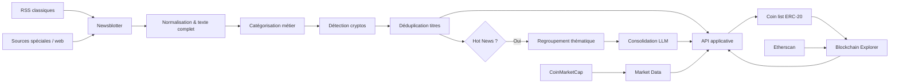

# 📰 ARIA Crypto-News — Workers Python de veille, NLP & automatisation

> **V1 publique, anonymisée — démonstration technique / portfolio.**  
> Ce dépôt présente une version nettoyée et durcie des workers Python développés pour la plateforme ARIA. Il ne contient pas les secrets, routes de production, référentiels internes, catalogues complets de sources, historiques de news, logs de production ni données applicatives.

🌐 **Présentation visuelle du projet :**  
https://zang-iaconsulting.com/projects/aria-news.html

## ✨ En un coup d’œil

| Repère | Description |
|---|---|
| 🧩 **4 workers métier** | Newsblotter, Hot News / LLM, Market Data, Blockchain Explorer |
| ⏱️ **5 min** | Cycle nominal du Newsblotter principal |
| 📰 **10 000 titres** | Fenêtre historique utilisée pour la détection de doublons |
| 🎯 **90 %** | Seuil historique de similarité de titres |
| 🗂️ **5 catégories** | Tokenomics, Risks, Adoption, Governance, Investment Analytics |
| 🤖 **LLM** | Consolidation éditoriale de groupes de Hot News avec OpenAI |
| 🔗 **REST API** | Lecture et publication automatisées vers la couche applicative |
| 🐳 **Docker** | Workers isolés, sans ports applicatifs exposés |

## 🎯 Vue d’ensemble

ARIA agrège en continu des informations issues de l’écosystème crypto : actualités, signaux de marché et métriques blockchain. Le rôle de cette chaîne Python est de transformer des flux hétérogènes en objets exploitables par la plateforme : news enrichies, Hot News consolidées, indicateurs de marché et métriques ERC-20.

Le dépôt public se concentre sur les **workers Python / Data / IA**. L’interface utilisateur, le backend applicatif, la base de données et l’infrastructure de production ne font pas partie de cette publication.

## 🏗️ Architecture générale



## 🧩 Les quatre briques métier

### 📰 1. Newsblotter

Le Newsblotter orchestre les collectes à intervalle régulier et combine deux voies :

- **RSS classiques** : parsing XML puis extraction et normalisation des articles ;
- **sources spéciales** : extraction statique ou Selenium/Chromium pour les pages nécessitant un rendu dynamique ;
- normalisation des dates en UTC ;
- sauvegarde locale du texte complet ;
- détection des cryptos citées ;
- catégorisation selon cinq axes métier ;
- contrôle des doublons sur une fenêtre historique de 10 000 titres avec RapidFuzz ;
- publication structurée vers l’API applicative.

Dans la version publique, un échec de collecte empêche la republication accidentelle d’un ancien payload et chaque sous-worker dispose d’un timeout borné.

### 🔥 2. Hot News / LLM

Lorsqu’une news satisfait les règles Hot News, le worker :

1. récupère les news récentes ;
2. recherche des articles similaires ;
3. regroupe les contenus partageant des tokens pertinents ;
4. compile les sources textuelles ;
5. génère une synthèse éditoriale via OpenAI ;
6. publie ou met à jour l’objet consolidé dans l’API ;
7. marque les news sources comme traitées uniquement après succès.

Les **prompts de production ne sont pas publiés**. `src/prompts.py` contient uniquement des gabarits publics minimaux permettant de comprendre l’interface technique.

### 📈 3. Market Data

Le worker Market Data utilise Chromium/Selenium pour collecter des informations publiques de classement d’exchanges, les sérialise en JSON puis les publie vers l’API configurée.

Le sélecteur web est volontairement isolé dans ce worker : les sites tiers peuvent faire évoluer leur HTML et nécessiter une maintenance indépendante du reste du pipeline.

### ⛓️ 4. Blockchain Explorer

Le worker Blockchain Explorer :

- récupère la coin list applicative ;
- filtre les actifs ERC-20 ;
- valide les contract addresses ;
- complète les `decimals` via Etherscan ;
- parcourt les holders avec pagination bornée ;
- élimine les adresses de burn / nulles ;
- calcule le nombre de holders, les concentrations ≥ 1 %, la supply observée et les écarts de cohérence ;
- publie un payload réduit aux champs attendus par l’API.

Les clés Etherscan restent uniquement dans les paramètres de requête transmis au client HTTP et ne sont jamais écrites dans les logs.

## 🧠 Règles NLP principales

Le pipeline historique combine plusieurs techniques volontairement simples et interprétables :

- **catégorisation par mots-clés** : Tokenomics, Risks, Adoption, Governance, Investment Analytics ;
- **détection d’entités crypto** à partir de tickers et noms de tokens ;
- **déduplication de titres** avec ratio de similarité et seuil de 90 % ;
- **détection Hot News** autour des familles Actor, TradFi, Action et Crypto ;
- **regroupement thématique** lorsque plusieurs tokens pertinents sont communs aux articles ;
- **consolidation LLM** pour produire un contenu éditorial unique à partir des sources regroupées.

Cette V1 publique conserve ces règles pour refléter le projet réel ; elle ne cherche pas à les remplacer rétroactivement par une architecture NLP plus récente.

## 🔭 Ce que nous ferions différemment aujourd’hui

Le projet a été conçu entre **2023 et 2025**, à une période où la collecte robuste de sources web dynamiques reposait encore largement sur des combinaisons de `requests`, BeautifulSoup, Selenium, sélecteurs CSS/XPath et traitements spécifiques par site. Cette architecture reste volontairement visible dans ce dépôt car elle correspond au système réellement développé.

Depuis, les **agents navigateur** et les frameworks de crawling orientés LLM ont fortement amélioré la manière d’aborder ce type de veille. Pour une nouvelle version d’ARIA, nous privilégierions une stratégie progressive :

1. **RSS, API et flux officiels en priorité**, lorsqu’ils existent : ce sont les sources les plus stables, les moins coûteuses et les plus simples à exploiter proprement ;
2. **Firecrawl** (`https://www.firecrawl.dev/`) pour transformer rapidement des pages ou des sites en Markdown/JSON propre, y compris lorsque le rendu JavaScript est nécessaire ;
3. **Crawl4AI** (`https://docs.crawl4ai.com/`) lorsqu’une solution open source, auto-hébergeable et très configurable est préférable, avec extraction CSS/XPath ou LLM ;
4. **Stagehand** (`https://www.stagehand.dev/`) pour les sources dynamiques nécessitant un navigateur, en combinant automatisation déterministe et actions guidées par IA afin de mieux absorber les changements de DOM ;
5. **Browser Use** (`https://browser-use.com/`) pour les parcours réellement agentiques et multi-étapes, lorsqu’un agent doit naviguer, interpréter une page et choisir lui-même les actions à effectuer.

Pour ARIA, l’approche la plus pertinente aujourd’hui serait donc probablement **hybride** : conserver des collecteurs déterministes pour les flux simples et stables, utiliser un crawler LLM-friendly pour la majorité des pages web, puis réserver les agents navigateur aux sources réellement complexes. Cela réduirait la quantité de code spécifique par site et améliorerait la résilience aux changements d’interface.

Ces outils ne suppriment toutefois ni les limites d’accès ni les obligations liées aux sites tiers. Une collecte moderne doit toujours respecter les conditions d’utilisation, `robots.txt` lorsque applicable, les limites de fréquence et les mécanismes d’accès autorisés ; l’objectif est d’améliorer la robustesse de l’extraction, **pas de contourner des protections d’accès**.

## 🗂️ Arborescence du dépôt

```text
ARIA_NEWS_GITHUB_V1_FINAL/
├── src/
│   ├── config.py
│   ├── http_safety.py
│   ├── io_utils.py
│   ├── llm.py
│   ├── prompts.py
│   ├── newsblotter/
│   │   ├── orchestrator.py
│   │   ├── rss_classic.py
│   │   ├── rss_classic_methods.py
│   │   ├── rss_special.py
│   │   ├── rss_special_methods.py
│   │   ├── parsing.py
│   │   └── publish_news.py
│   ├── hotnews/
│   │   ├── hotnews_worker.py
│   │   ├── hotnews_methods.py
│   │   └── daily_brief.py
│   ├── market_data/
│   │   └── coinmarketcap_worker.py
│   └── blockchain/
│       ├── erc20_worker.py
│       └── etherscan_methods.py
├── runtime/
│   ├── data_main/
│   ├── data_news/
│   ├── json_rss_to_send/
│   ├── data_logs/
│   ├── RESUM_Hot_News/
│   ├── data_coinmarketcap/
│   └── data_scan_explorer_tokens/
├── examples/
│   └── reference_data/
├── docs/
│   └── images/
├── docker/
│   ├── Dockerfile.newsblotter
│   ├── Dockerfile.hotnews
│   ├── Dockerfile.market
│   └── Dockerfile.blockchain
├── requirements/
├── .env.example
├── .dockerignore
├── .gitattributes
├── .gitignore
├── docker-compose.yml
├── requirements.txt
├── SECURITY.md
└── README.md
```

Les `.gitkeep` rendent visibles les principaux volumes runtime sans publier leur contenu réel.

## 📦 Référentiels non publiés

Le fonctionnement complet nécessite plusieurs référentiels opérationnels. Ils sont volontairement absents du dépôt :

- catalogue complet des sources RSS et web ;
- sélecteurs réels propres aux sources spéciales ;
- taxonomie métier complète ;
- liste interne de cryptos et acronymes ;
- référentiel applicatif Actor / TradFi / Action / Crypto.

`examples/reference_data/` contient uniquement des **exemples synthétiques de structure**. Ces exemples ne sont pas les données utilisées en production.

## 🔐 Mesures de sécurité de la V1 publique

Cette édition GitHub ajoute des protections qui n’étaient pas toutes présentes dans les scripts historiques :

- secrets exclusivement injectés par variables d’environnement ;
- aucune URL de backend de production dans le code ;
- base applicative par défaut sur `https://example.invalid` ;
- HTTPS obligatoire pour les appels réseau ;
- contrôle DNS contre les destinations privées/locales pour le scraping ;
- revalidation de chaque redirection HTTP ;
- suppression des headers d’authentification lors d’une redirection cross-origin ;
- timeouts HTTP, LLM, Selenium et sous-processus ;
- taille maximale des réponses HTTP ;
- rejet des flux XML comportant des déclarations DTD/ENTITY ;
- validation des contract addresses ERC-20 ;
- chemins runtime contraints à la racine `/app` ;
- neutralisation des préfixes de formule dans les exports Excel de diagnostic ;
- écritures JSON/TXT atomiques pour les artefacts critiques ;
- `umask 0077` sur les workers principaux ;
- conteneurs exécutés avec un utilisateur non-root ;
- filesystem racine Docker en lecture seule ;
- `no-new-privileges` et suppression des Linux capabilities ;
- aucun port Selenium/VNC exposé ;
- `.gitignore` et `.dockerignore` excluant secrets, logs et données runtime ;
- Dependabot pour le suivi des dépendances Python et des images Docker.

Voir également [`SECURITY.md`](SECURITY.md).

## ⚙️ Configuration

Copier le fichier d’exemple :

```bash
cp .env.example .env
```

Puis renseigner au minimum les secrets correspondant aux workers réellement utilisés :

```text
ARIA_API_KEY
ARIA_WALLET_API_KEY
OPENAI_API_KEY
ETHERSCAN_API_KEY
```

Les URLs et routes présentes dans `.env.example` sont **génériques**. Elles ne décrivent pas l’infrastructure de production. Le Compose n’injecte pas tout le fichier `.env` dans chaque conteneur : chaque service reçoit uniquement les secrets et paramètres dont il a besoin. `ARIA_DOCKER_UID` et `ARIA_DOCKER_GID` permettent d’aligner l’utilisateur non-root des conteneurs avec les permissions des volumes bind-mountés sur l’hôte.

## 🐳 Docker

Construction des services principaux :

```bash
docker compose build
```

Démarrage :

```bash
docker compose up -d
```

Le service `newsblotter` contient l’orchestrateur principal et peut déclencher les workers Hot News et Market Data comme dans la chaîne historique. Le service `blockchain-explorer` fonctionne indépendamment. Le brief Hot News quotidien est isolé dans `hotnews-daily-brief`.

Un Dockerfile Market Data autonome est également fourni pour montrer l’isolation de cette brique ; le `docker-compose.yml` principal évite de la lancer une seconde fois en parallèle de l’orchestrateur.

## 🧰 Technologies principales

- Python 3.12
- pandas / NumPy
- requests
- BeautifulSoup / lxml
- Selenium / Chromium headless
- RapidFuzz
- OpenAI API
- Etherscan API
- CoinMarketCap
- JSON / Excel pour les artefacts intermédiaires
- Docker / Docker Compose
- REST API

La V1 publique utilise des dépendances modernisées et remplace notamment l’ancien couple FuzzyWuzzy / Levenshtein par RapidFuzz.

## 🖼️ Visuels

Le dossier `docs/images/` est réservé à de futures captures anonymisées, par exemple :

```text
docs/images/aria-news-architecture.png
docs/images/aria-news-interface.png
```

Aucun screenshot contenant des données internes n’est inclus par défaut.

## 📊 Résultat opérationnel

La chaîne automatisait l’alimentation continue de la plateforme avec :

- des news collectées et structurées ;
- une catégorisation métier et les cryptos concernées ;
- des doublons filtrés ;
- des Hot News regroupées et consolidées par LLM ;
- des indicateurs auxiliaires de marché ;
- des métriques ERC-20 issues d’Etherscan.

Le projet illustre surtout la mise en place de **workers indépendants mais coordonnés**, capables d’enrichir une couche applicative existante sans mélanger collecte, NLP, génération LLM et analyse blockchain dans un seul service monolithique.

## ⚠️ Limites de cette publication

Ce dépôt est une démonstration technique et **n’est pas un produit clé en main**. Les référentiels de production et l’API applicative ne sont pas fournis. Les scrapers dépendent également du HTML et des conditions d’accès des sites tiers ; toute utilisation doit respecter leurs conditions, leur politique d’accès et les règles applicables.

Les contrôles SSRF et Docker réduisent la surface d’attaque mais ne remplacent pas un sandbox réseau dédié lorsqu’un système doit traiter des URLs totalement non fiables avec un niveau d’assurance élevé.

## 📜 Licence

Aucune licence open source n’est accordée par défaut par ce dépôt tant qu’un fichier `LICENSE` explicite n’a pas été ajouté.
